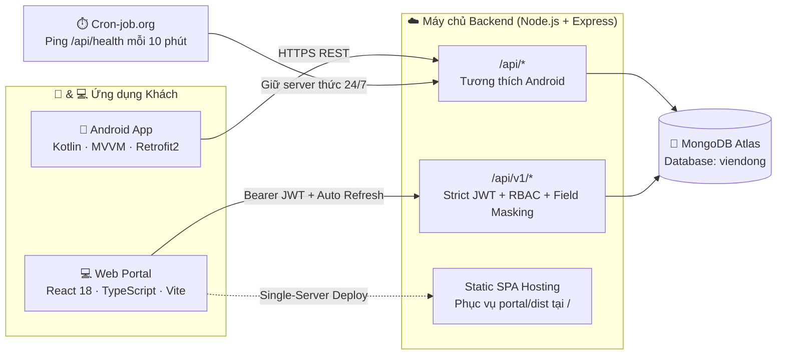
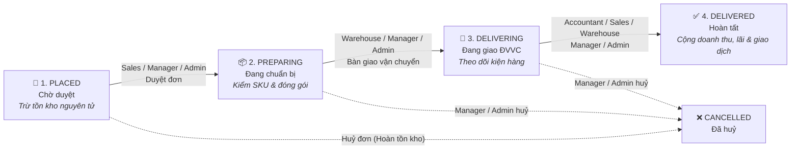
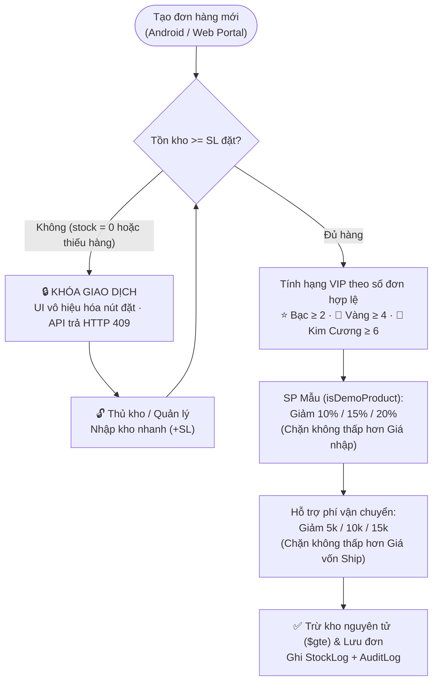

<div align="center">

# 🏢 Viễn Đông Sales — Hệ thống Quản Lý Doanh Nghiệp Toàn Diện

**Android App (Kotlin) · Web Portal (React + TypeScript) · Backend API (Node.js + Express) · MongoDB Atlas**

[](./app)
[](./portal)
[](./backend)
[](https://www.mongodb.com/atlas)
[](#-ma-trận-phân-quyền-rbac--tài-khoản-mẫu)

<p align="center">
  <a href="#-tính-năng-nổi-bật">✨ Tính năng</a> •
  <a href="#-kiến-trúc-hệ-thống">🏗️ Kiến trúc</a> •
  <a href="#-quy-trình-vận-hành-nghiệp-vụ">🔄 Quy trình</a> •
  <a href="#-ma-trận-phân-quyền-rbac--tài-khoản-mẫu">🔐 RBAC</a> •
  <a href="#-hướng-dẫn-cài-đặt--chạy-cục-bộ">⚙️ Cài đặt</a> •
  <a href="#-triển-khai-miễn-phí-247-lên-cloud">☁️ Deploy 24/7</a> •
  <a href="#-kiểm-thử-tự-động">🧪 Kiểm thử</a>
</p>

> Giải pháp quản trị vận hành bán hàng thời gian thực cho **Công ty TNHH Thương Mại & Dịch Vụ Viễn Đông**, đồng bộ dữ liệu tức thời giữa **Ứng dụng Android** và **Web Portal Quản trị** qua **MongoDB Atlas**.

</div>

---

## ✨ Tính năng Nổi bật

<table>
  <tr>
    <td width="50%" valign="top">
      <h3>📦 Kho hàng, Giá Nhập/Bán & Khóa Giao Dịch</h3>
      <ul>
        <li>Quản lý đầy đủ <strong>Giá nhập (Import Price)</strong>, <strong>Giá bán (Export Price)</strong>, biên lợi nhuận và cờ <strong>Sản phẩm mẫu (Demo)</strong>.</li>
        <li><strong>🔒 Khóa giao dịch theo tồn kho (Trade Lock):</strong> Khi tồn kho = 0 hoặc SL đặt &gt; tồn kho, hệ thống tự động khóa nút đặt hàng trên UI và chặn nguyên tử (<code>$gte</code>) ở tầng MongoDB (<code>HTTP 409</code>).</li>
        <li><strong>🔓 Mở khóa tức thì:</strong> Thủ kho / Quản lý nhập kho nhanh ngay tại bảng sản phẩm hoặc trong Drawer tạo đơn, kèm lịch sử biến động kho (<code>StockLog</code>).</li>
        <li><strong>Nhập hàng loạt 100+ SP:</strong> Hỗ trợ file <code>.xlsx</code> / <code>.csv</code> (có bộ file mẫu trong <code>sample-data/</code>) hoặc dán nhanh nhiều dòng văn bản.</li>
      </ul>
    </td>
    <td width="50%" valign="top">
      <h3>🛒 Đơn hàng 4 Bước & In Hóa Đơn</h3>
      <ul>
        <li>Chuẩn hóa quy trình vận hành <strong>4 giai đoạn</strong> rõ ràng: <code>Chờ duyệt</code> → <code>Chuẩn bị</code> → <code>Giao ĐVVC</code> → <code>Hoàn tất</code> (hoặc <code>Đã huỷ</code> tự hoàn tồn kho).</li>
        <li>Web Portal hỗ trợ chuyển đổi linh hoạt giữa chế độ <strong>Bảng chi tiết</strong> và <strong>Kanban 4 cột</strong>.</li>
        <li><strong>Xem trước báo giá trực tiếp (<code>POST /orders/preview</code>):</strong> Tự tính chiết khấu VIP, phí ship sau hỗ trợ, trạng thái khóa kho và lợi nhuận dự kiến trước khi chốt đơn.</li>
        <li><strong>Xuất & In phiếu hóa đơn:</strong> Giao diện in tối ưu (<code>@media print</code>) kèm đầy đủ chi tiết giảm giá VIP & thông tin công ty.</li>
      </ul>
    </td>
  </tr>
  <tr>
    <td width="50%" valign="top">
      <h3>📊 Báo cáo Doanh thu, Lợi nhuận & Kênh B2B/B2C</h3>
      <ul>
        <li>100% số liệu thật từ đơn hàng hoàn tất (<code>DELIVERED</code>), tự động cập nhật ngay khi đơn được xác nhận giao thành công.</li>
        <li>Biểu đồ cột so sánh <strong>Doanh thu ↔ Lợi nhuận ròng</strong> theo <strong>7 ngày / Tháng / 6 tháng / Tùy chọn ngày</strong>.</li>
        <li>Phân tách trực quan tỷ trọng kênh <strong>🏢 Doanh nghiệp (B2B)</strong> vs <strong>🛍️ Bán lẻ (B2C)</strong>, Top 15 sản phẩm lãi cao, sổ đối soát <code>COD / BANK / WALLET</code> và xuất báo cáo <strong>CSV</strong>.</li>
      </ul>
    </td>
    <td width="50%" valign="top">
      <h3>👑 Đại diện VIP & Quản trị RBAC / Audit Log</h3>
      <ul>
        <li>Tự động phân hạng theo tần suất đơn hợp lệ: <strong>⭐ VIP Bạc</strong> → <strong>👑 VIP Vàng</strong> → <strong>💎 VIP Kim Cương</strong>.</li>
        <li><strong>Quyền lợi VIP an toàn biên lãi:</strong> Giảm giá sản phẩm mẫu (không thấp hơn giá nhập) & hỗ trợ phí ship <strong>không bao giờ thấp hơn giá vốn vận chuyển</strong>.</li>
        <li>Cấu hình động ngưỡng VIP, phí ship sàn và ngưỡng tồn kho thấp ngay trên Web Portal.</li>
        <li><strong>Bảo mật RBAC 6 vai trò</strong> + tự động ẩn <code>importPrice</code> / <code>shippingCost</code> (Field Masking) + <strong>Nhật ký kiểm toán (Audit Log)</strong> có JSON diff <code>before/after</code>.</li>
      </ul>
    </td>
  </tr>
</table>

---

## 🏗️ Kiến trúc Hệ thống



### Công nghệ sử dụng

| Phân hệ | Công nghệ & Thư viện chính |
| --- | --- |
| **Android App (`app/`)** | Kotlin, ViewBinding, MVVM (`StateFlow` / Coroutines), Retrofit2 + Moshi + OkHttp, Custom Canvas Charts, `ExcelProductParser` (`.xlsx`/`.csv`) |
| **Web Portal (`portal/`)** | React 18, TypeScript (strict), Vite 6, React Router v7, Lucide Icons, Light High-Contrast Design System (`theme.css`) |
| **Backend (`backend/`)** | Node.js, Express 4, Mongoose 8, JWT (Access + Refresh Rotation), `bcryptjs`, CSV Exporter, Node Test Runner (`node --test`) |
| **Database** | MongoDB Atlas (`viendong`) với 10 collections: `products`, `orders`, `users`, `customerprofiles`, `policysettings`, `stocklogs`, `auditlogs`, `transactions`, `notifications`, `calendardays` |

---

## 🔄 Quy trình Vận hành Nghiệp vụ

### 1. Lộ trình Xử lý Đơn hàng 4 Bước theo Vai trò RBAC



### 2. Quy trình Khóa Giao Dịch (Trade Lock) & Ưu đãi Đại diện VIP



---

## 🔐 Ma trận Phân quyền RBAC & Tài khoản mẫu

Hệ thống hỗ trợ **6 vai trò** kiểm soát chặt cả ở tầng API (`requirePermission` + `fieldMask.js`) lẫn giao diện Web Portal (`ProtectedRoute` + ẩn/hiện menu & cột dữ liệu):

| Vai trò | Email mẫu | Mật khẩu mặc định | Giá nhập & Lãi | Kho & Mở khóa GD | Đơn hàng | Báo cáo & CSV | User / Policy / Audit |
| --- | --- | --- | :---: | :---: | :---: | :---: | :---: |
| **🔴 Admin** | `admin@viendong.vn` | `Admin@123` | ✅ Toàn quyền | ✅ Toàn quyền | ✅ Toàn quyền | ✅ Doanh thu + Lãi | ✅ Toàn quyền |
| **🟣 Manager** | `manager@viendong.vn` | `Manager@123` | ✅ Xem & sửa | ✅ Tạo/Sửa/Nhập kho | ✅ Duyệt/Giao/Huỷ | ✅ Doanh thu + Lãi | 👁️ Xem Policy & Audit |
| **🔵 Sales** | `sales@viendong.vn` | `Sales@123` | ❌ **Bị ẩn** | 👁️ Chỉ xem | ✅ Tạo/Duyệt/Hoàn tất | 🟡 Chỉ Doanh thu | 👁️ Xem Policy |
| **🟠 Warehouse** | `warehouse@viendong.vn` | `Warehouse@123` | ❌ **Bị ẩn** | ✅ Nhập kho/Mở khóa | 🟡 Giao ĐVVC/Hoàn tất | ❌ Không | ❌ Không |
| **🟢 Accountant** | `accountant@viendong.vn` | `Accountant@123` | ✅ Xem chi tiết | 👁️ Chỉ xem + Log kho | 🟡 Xác nhận hoàn tất | ✅ Đầy đủ + Sổ GD | 👁️ Xem Policy & Audit |
| **⚪ B2B Partner** | *(tạo bởi Admin)* | — | ❌ **Bị ẩn** | 👁️ Danh mục SP | 🟡 Chỉ đơn của mình | ❌ Không | ❌ Không |

> ⚠️ **Bảo mật khi chạy Production:** Hãy đổi ngay mật khẩu của toàn bộ tài khoản mẫu trong mục **Cài đặt & RBAC → Tài khoản & RBAC** và đặt `JWT_SECRET` / `JWT_REFRESH_SECRET` mạnh (≥ 32 ký tự ngẫu nhiên) trước khi đưa vào vận hành thực tế.

---

## 📂 Cấu trúc Thư mục Dự án

```text
Qu-n-L-Doanh-Nghi-p/
├── 📱 app/                                  # Ứng dụng Android (Kotlin, MVVM, Retrofit2)
│   └── src/main/java/com/example/
│       ├── api/                             # RetrofitClient (auto-fallback + HTTPS), ApiService, ApiModels
│       ├── model/                           # SalesModels (Order, Product, VipTier, B2B/B2C...), AppClock
│       ├── repository/                      # SalesRepository (REST sync & Trade-Lock 409 handling)
│       ├── ui/                              # Fragments, Adapters, BottomSheets, IncomeBarChartView
│       ├── utils/                           # ExcelProductParser (.xlsx/.csv), ImageUtils
│       └── viewmodel/                       # SalesViewModel (StateFlow & business calculations)
│
├── 💻 portal/                               # Web Portal Quản trị (React 18 + TypeScript + Vite)
│   └── src/
│       ├── api/client.ts                    # Fetch client + Bearer JWT + Auto Refresh Token + CSV download
│       ├── context/AuthContext.tsx          # Phiên đăng nhập & kiểm tra quyền RBAC
│       ├── components/                      # AppShell, ProtectedRoute, CreateOrderDrawer
│       ├── pages/                           # Login, Dashboard, Products, Orders, Reports, Customers, Settings
│       ├── styles/theme.css                 # Giao diện sáng tương phản cao, hỗ trợ in ấn (@media print)
│       ├── types/api.ts                     # Kiểu TypeScript đầy đủ cho /api/v1/*
│       └── utils/format.ts                  # Định dạng tiền VNĐ, badge trạng thái & hạng VIP
│
├── ⚙️ backend/                              # Backend Server (Node.js + Express + Mongoose)
│   ├── config/rbac.js                       # Định nghĩa 6 vai trò, quyền & luật chuyển trạng thái đơn
│   ├── controllers/                         # auth, user, product, order, report, customer, dashboard
│   ├── middlewares/                         # auth.js (JWT + legacy transition), fieldMask.js (ẩn giá vốn)
│   ├── models/                              # 10 Mongoose Schemas (Product, Order, User, StockLog, AuditLog...)
│   ├── routes/                              # Khai báo route /api/* và /api/v1/*
│   ├── services/                            # authService, policyService, auditService, csvService, helpers
│   ├── tests/                               # phase1-auth-rbac, phase2-portal-apis, phase5-portal-e2e
│   ├── app.js                               # Express app + CORS delegate + SPA static hosting
│   ├── server.js                            # Entry point, kết nối MongoDB Atlas & adb reverse
│   └── seedData.js                          # Tự khởi tạo dữ liệu mẫu & tài khoản RBAC mặc định
│
├── 📊 sample-data/                          # Bộ file Excel/CSV mẫu (10–100 sản phẩm)
├── 📄 .env.example                          # Mẫu cấu hình BACKEND_URL cho Android App
├── 📄 PORTAL_GUIDE.md                       # Tài liệu chi tiết vận hành Web Portal
├── 📄 render.yaml                           # Blueprint cấu hình triển khai Render
└── 🚀 start-backend.sh                      # Script khởi chạy nhanh Backend trên Linux/macOS
```

---

## ⚙️ Hướng dẫn Cài đặt & Chạy Cục bộ

### Yêu cầu môi trường
- **Node.js** `v18+` (khuyên dùng `v20` hoặc `v22`) & **npm**
- **Android Studio** (Jellyfish/Ladybug trở lên) + **JDK 17**
- Tài khoản **MongoDB Atlas** (gói M0 Free)

---

### Bước 1: Clone dự án & Cấu hình biến môi trường

```bash
git clone <url-repository-cua-ban>
cd Qu-n-L-Doanh-Nghi-p
```

Tạo file `backend/.env` từ file mẫu [`backend/.env.example`](./backend/.env.example):

```env
MONGODB_URI=mongodb+srv://<username>:<password>@<cluster>.mongodb.net/viendong?retryWrites=true&w=majority
PORT=5000
JWT_SECRET=thay-bang-chuoi-bi-mat-ngau-nhien-dai-it-nhat-32-ky-tu
JWT_REFRESH_SECRET=thay-bang-chuoi-refresh-bi-mat-khac-32-ky-tu
JWT_ACCESS_EXPIRES=2h
JWT_REFRESH_EXPIRES=7d
REQUIRE_AUTH=false
CORS_ORIGIN=http://localhost:5173,http://localhost:5000
```

---

### Bước 2: Chạy Backend & Web Portal

#### 🔹 Cách A — Chế độ Phát triển (Hot-Reload, 2 terminal)
```bash
# Terminal 1 — Khởi chạy Backend (cổng 5000)
cd backend
npm install
npm run dev
```

```bash
# Terminal 2 — Khởi chạy Web Portal (cổng 5173, tự proxy /api → localhost:5000)
cd portal
npm install
npm run dev
```
👉 Mở trình duyệt tại **`http://localhost:5173`**.

#### 🔹 Cách B — Chế độ Trọn gói 1 Máy chủ duy nhất (cổng 5000)
```bash
# 1. Cài đặt & build Web Portal ra portal/dist
npm --prefix portal install --include=dev && npm --prefix portal run build

# 2. Cài đặt & khởi chạy Backend (tự động phục vụ Web Portal tại "/")
npm --prefix backend install && npm --prefix backend start
```
👉 Mở trình duyệt tại **`http://localhost:5000`**.

---

### Bước 3: Chạy Ứng dụng Android

1. *(Tùy chọn)* Tạo file `.env` tại **thư mục gốc dự án** (tham khảo [`.env.example`](./.env.example)) để đặt địa chỉ backend mặc định:
   ```env
   # Chạy với máy ảo Emulator:
   BACKEND_URL=http://10.0.2.2:5000/api/

   # Hoặc trỏ thẳng lên server Cloud Render:
   # BACKEND_URL=https://<ten-app>.onrender.com/api/
   ```
2. Mở dự án trong **Android Studio** → bấm **Sync Project with Gradle Files** → bấm **Run (`▶`)** (hoặc chạy `./gradlew installDebug`).
3. Nếu dùng điện thoại thật qua cáp USB với backend trên máy tính, chạy thêm:
   ```bash
   adb reverse tcp:5000 tcp:5000
   ```
   *(Ngoài ra, bạn có thể đổi URL/IP Server bất cứ lúc nào ngay trên app tại **Hồ sơ → Cấu hình IP → Tự nhập IP khác**).*

---

## ☁️ Triển khai Miễn phí 24/7 lên Cloud

Hệ thống có thể vận hành **miễn phí 100% và hoạt động 24/7** bằng **MongoDB Atlas (Free M0) + Render (Free Web Service) + Cron-job.org**:

1. **MongoDB Atlas:** Vào **Network Access** → thêm `0.0.0.0/0` để cho phép Render kết nối.
2. **Render.com:** Tạo **New Web Service** kết nối repo GitHub với cấu hình:
   - **Region:** `Singapore`
   - **Root Directory:** *(để trống — gốc repo)*
   - **Build Command:** *(có `--include=dev` để cài `@types/react`, `typescript`, `vite` kể cả khi `NODE_ENV=production`)*
     ```bash
     npm --prefix portal install --include=dev && npm --prefix portal run build && npm --prefix backend install
     ```
   - **Start Command:**
     ```bash
     npm --prefix backend start
     ```
   - **Environment Variables:** `NODE_ENV=production`, `MONGODB_URI`, `JWT_SECRET`, `JWT_REFRESH_SECRET`, `CORS_ORIGIN=https://<ten-app>.onrender.com`, `REQUIRE_AUTH=false`, `SERVE_PORTAL=true`.
3. **Giữ Server thức 24/7:** Tạo 1 job miễn phí trên `https://cron-job.org` gọi `GET https://<ten-app>.onrender.com/api/health` mỗi **10 phút**.
4. **Kết nối Android App:** Đặt `BACKEND_URL=https://<ten-app>.onrender.com/api/` trong `.env` gốc (rồi build lại APK) hoặc nhập thẳng vào **Hồ sơ → Cấu hình IP** trên app.

---

## 📡 Tổng quan REST API

<details>
<summary><b>Nhấn để xem danh sách Endpoint chính (<code>/api/v1/*</code> cho Web Portal & <code>/api/*</code> tương thích Android)</b></summary>

| Nhóm | Method & Endpoint | Mô tả |
| --- | --- | --- |
| **Hệ thống** | `GET /api/health` | Kiểm tra trạng thái server & chế độ xác thực |
| **Xác thực** | `POST /api/v1/auth/login`, `/refresh`, `/logout`, `GET /me` | Đăng nhập JWT, xoay vòng Refresh Token, lấy hồ sơ & quyền |
| **Kho hàng** | `GET /POST /PUT /DELETE /api/v1/products` | Phân trang, lọc tồn kho/demo, quản lý giá nhập/bán (có Field Masking) |
| **Khóa GD & Kho** | `GET /products/locked`, `PATCH /products/:id/restock`, `GET /products/:id/stock-logs`, `POST /products/bulk`, `GET /products/export` | Sản phẩm khóa GD, nhập kho mở khóa, nhật ký kho, nhập hàng loạt, xuất CSV |
| **Đơn hàng** | `GET /POST /api/v1/orders`, `POST /orders/preview`, `PATCH /orders/:id/status`, `GET /orders/:id/invoice`, `GET /orders/export` | Tạo đơn (chống âm kho `409`), xem trước VIP, chuyển trạng thái RBAC, hóa đơn, xuất CSV |
| **Báo cáo** | `GET /api/v1/reports/income`, `/channels`, `/top-products`, `/export`, `GET /transactions` | Thống kê Doanh thu/Lãi, tỷ trọng B2B/B2C, Top SP, sổ giao dịch, xuất CSV |
| **Đại diện VIP** | `GET /api/v1/customers/vip`, `GET /PATCH /customers/:phone` | Phân hạng VIP tự động, lịch sử mua & cập nhật hồ sơ CRM |
| **Quản trị** | `GET/POST/PATCH /api/v1/users`, `GET/PUT /settings/policy`, `GET /audit-logs` | Quản lý tài khoản RBAC, cấu hình VIP/Ship động & Nhật ký kiểm toán |

</details>

---

## 🧪 Kiểm thử Tự động

```bash
# 1. Backend: Unit + HTTP Integration + E2E 5 vai trò RBAC & tương thích Android (8/8 tests)
cd backend && npm test

# 2. Web Portal: Kiểm tra TypeScript strict (tsc -b) & build production bundle
cd portal && npm run build

# 3. Android App: Unit Tests nghiệp vụ (VIP, B2B/B2C, Trade Lock, Lợi nhuận) & build Debug APK
./gradlew :app:testDebugUnitTest :app:assembleDebug
```

---

<div align="center">
  <sub>Phát triển cho <strong>Công ty TNHH Thương Mại & Dịch Vụ Viễn Đông</strong> • Đồng bộ thời gian thực trên Android & Web Portal</sub>
</div>
